# UML — Sistema de Gestão e Despensa

Diagramas em Mermaid (renderizam no GitHub, no VS Code com a extensão *Markdown Preview Mermaid* e em <https://mermaid.live>).

## 1. Arquitetura e implantação

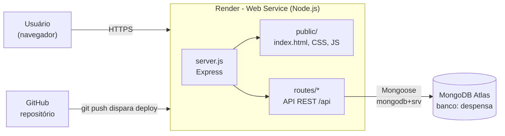

## 2. Casos de uso

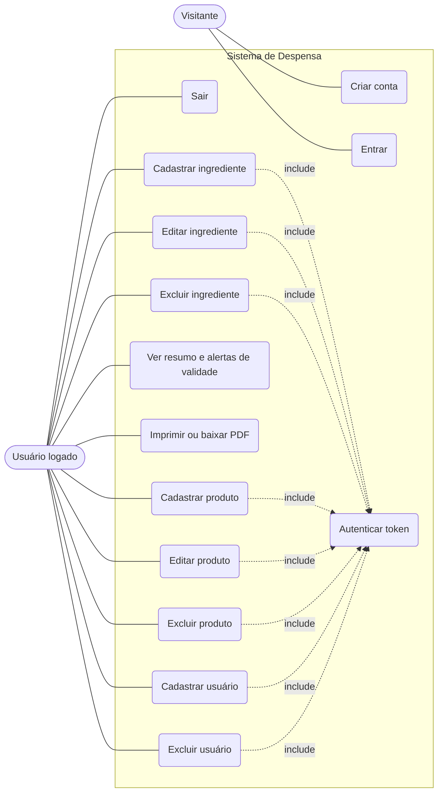

## 3. Diagrama de classes (back-end)

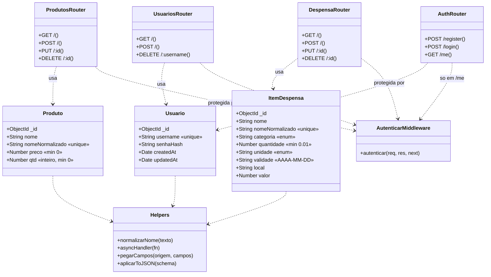

## 4. Estados da interface (front-end)

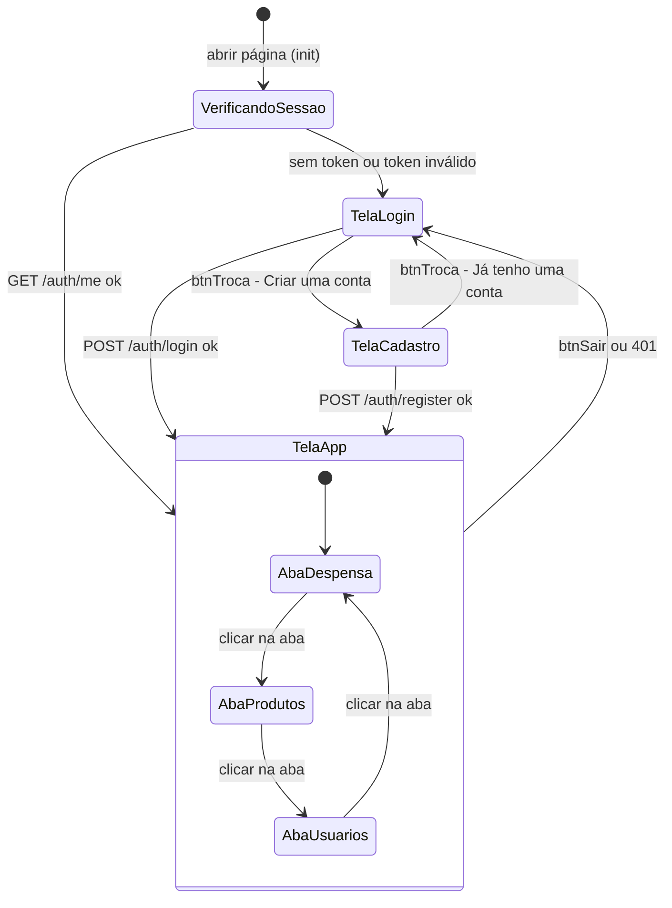

## 5. Sequências — um diagrama por comando

### 5.1 Criar conta (`btnAuth` em modo cadastro) — `POST /api/auth/register`

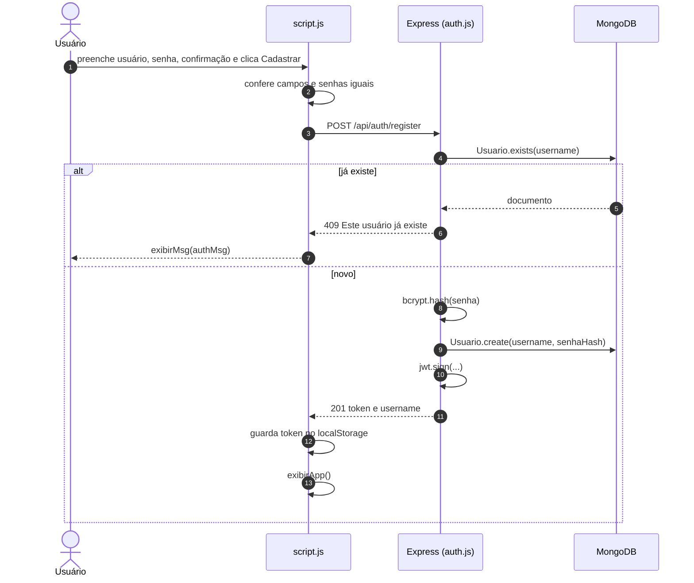

### 5.2 Entrar (`btnAuth` em modo login) — `POST /api/auth/login`

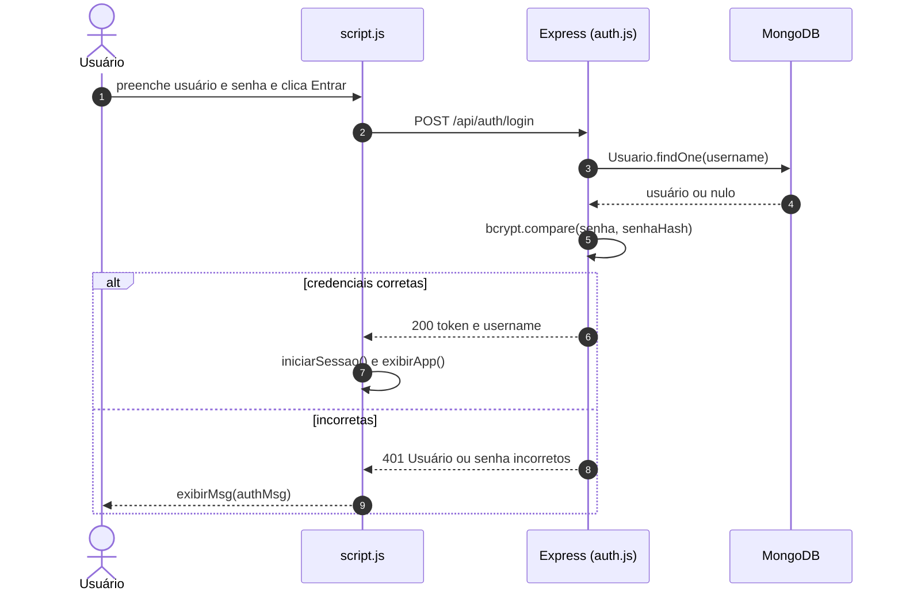

### 5.3 Abrir a página com sessão salva (`init`) — `GET /api/auth/me` e carga dos dados

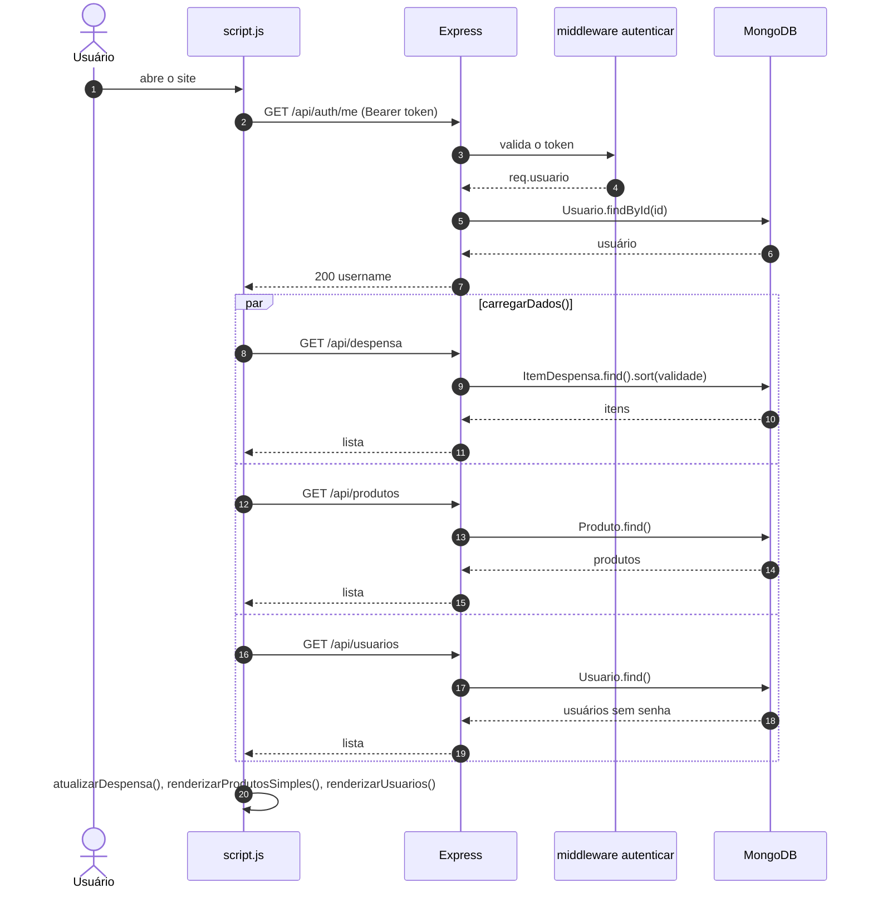

### 5.4 Sair (`btnSair`) e sessão expirada

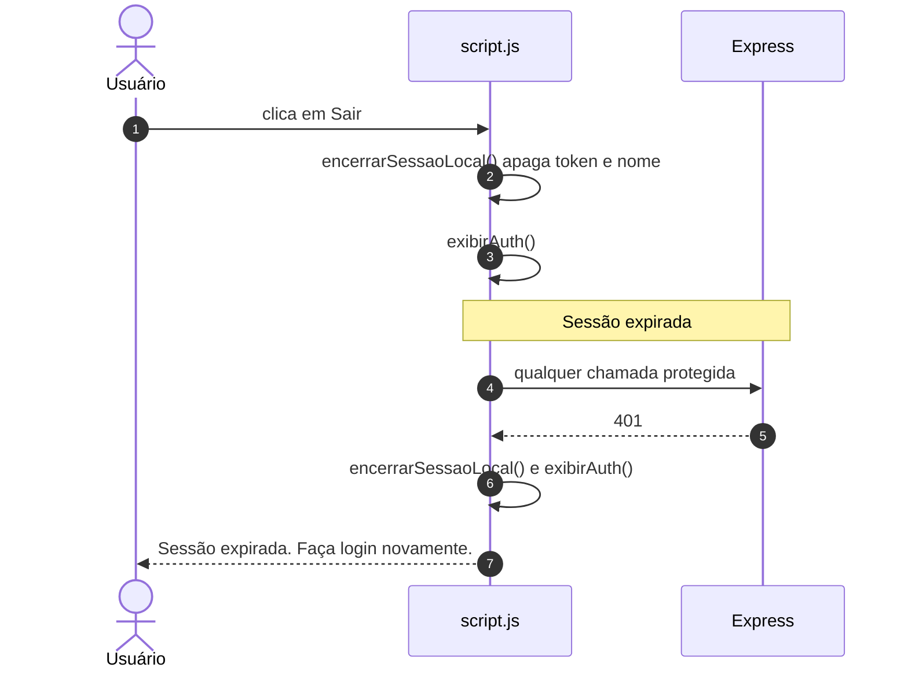

### 5.5 Cadastrar ou editar ingrediente (formulário da despensa) — `POST` / `PUT /api/despensa`

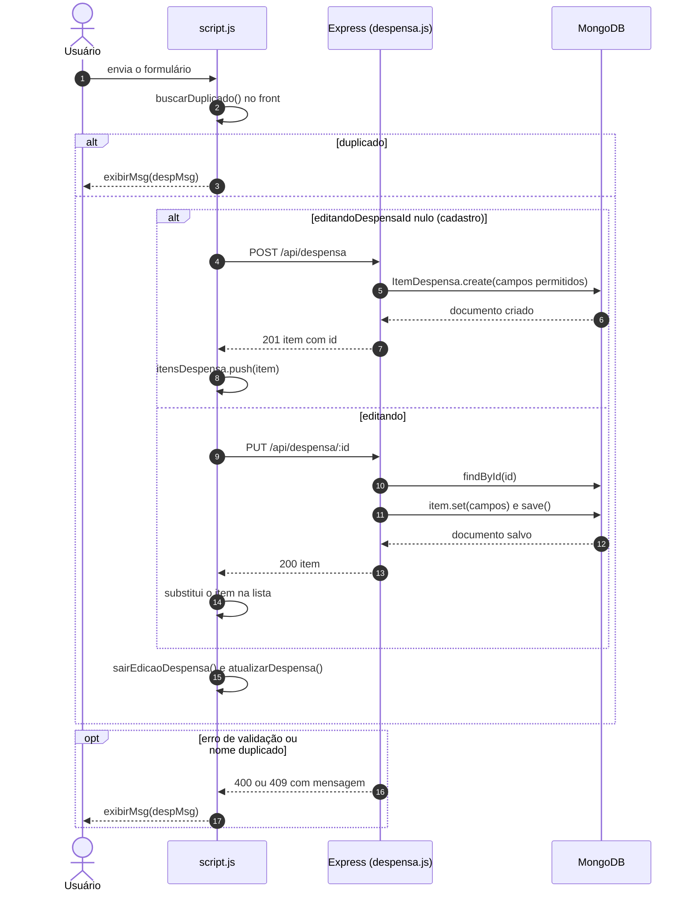

### 5.6 Excluir ingrediente (botão Excluir) — `DELETE /api/despensa/:id`

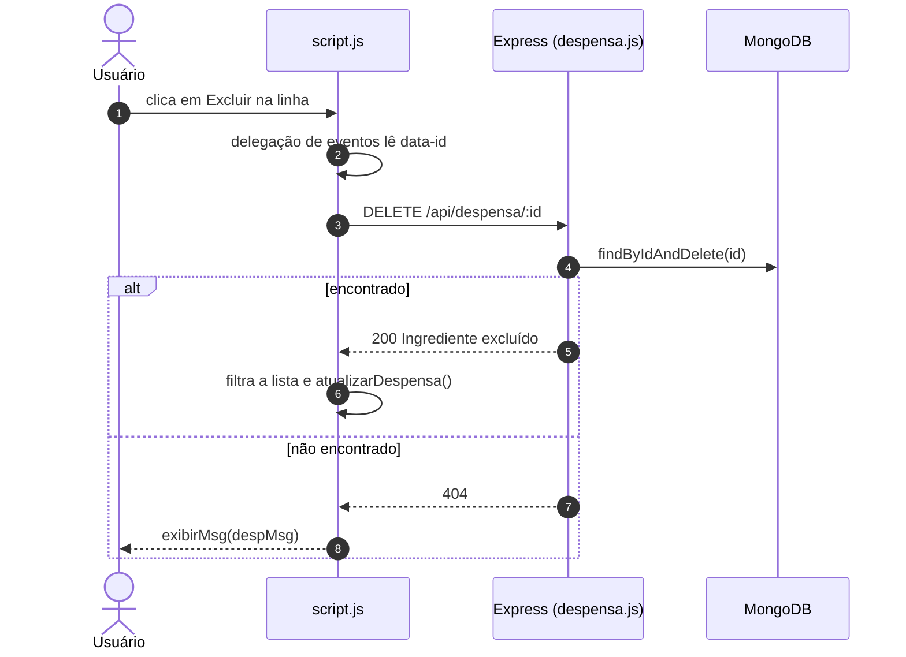

### 5.7 Produtos gerais — `POST` / `PUT` / `DELETE /api/produtos`

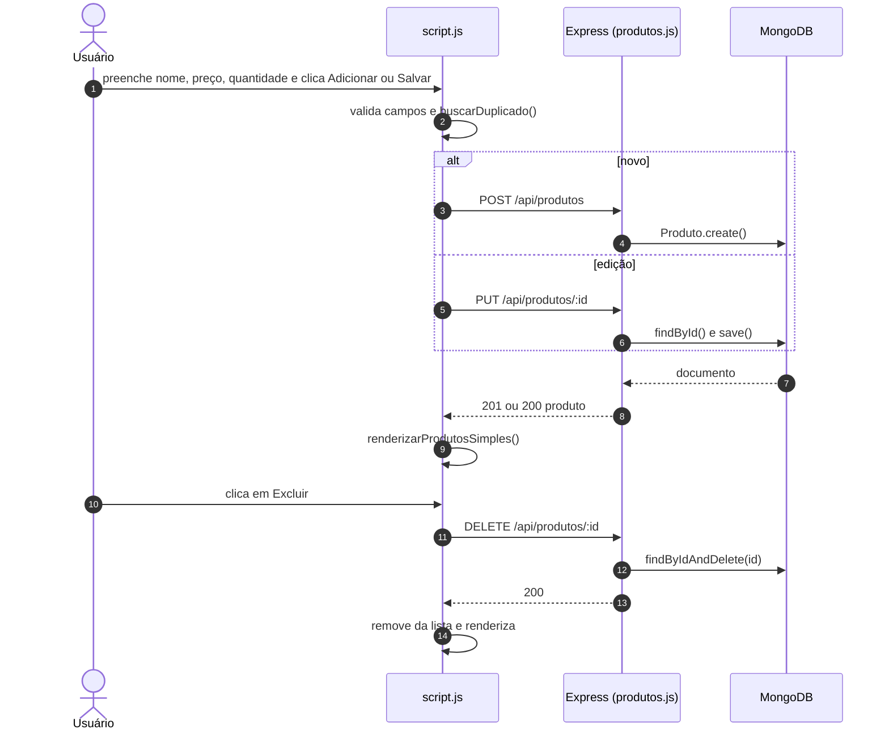

### 5.8 Usuários — `POST /api/usuarios` e `DELETE /api/usuarios/:username`

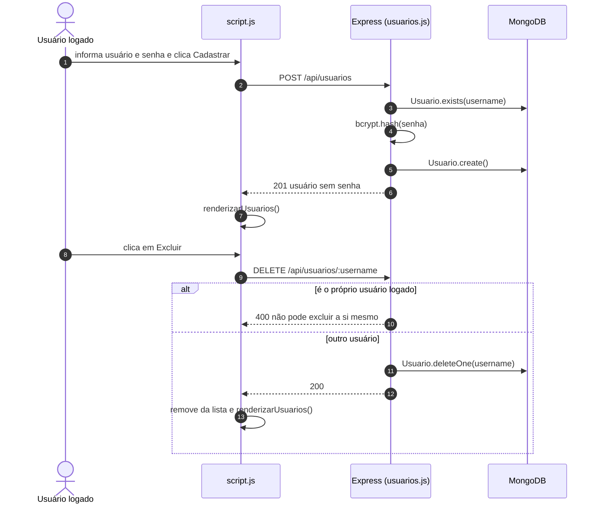

### 5.9 Relatório (`btnImprimir` e `btnPdf`) — somente no navegador

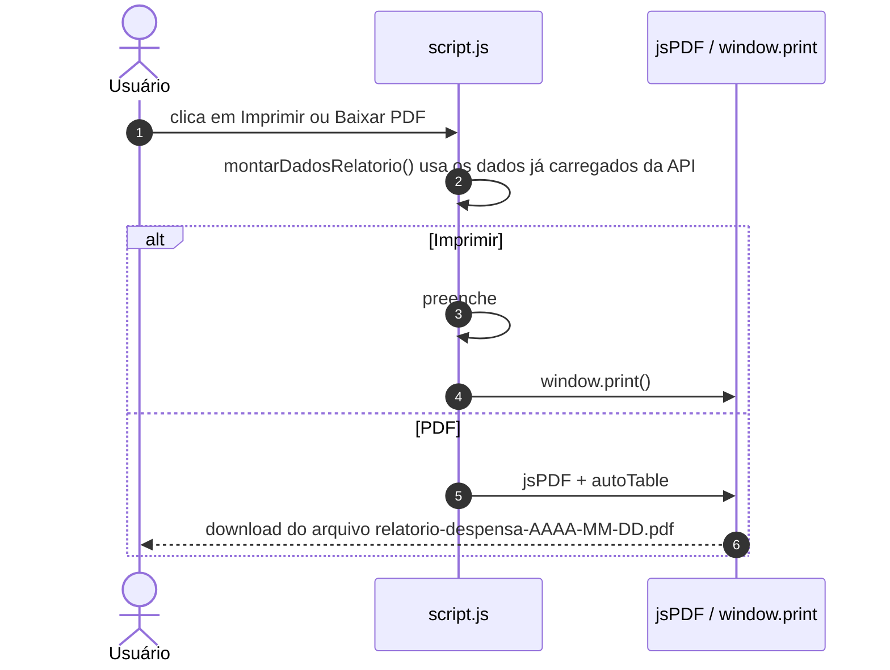

### 5.10 Deploy (comandos de terminal e Render)

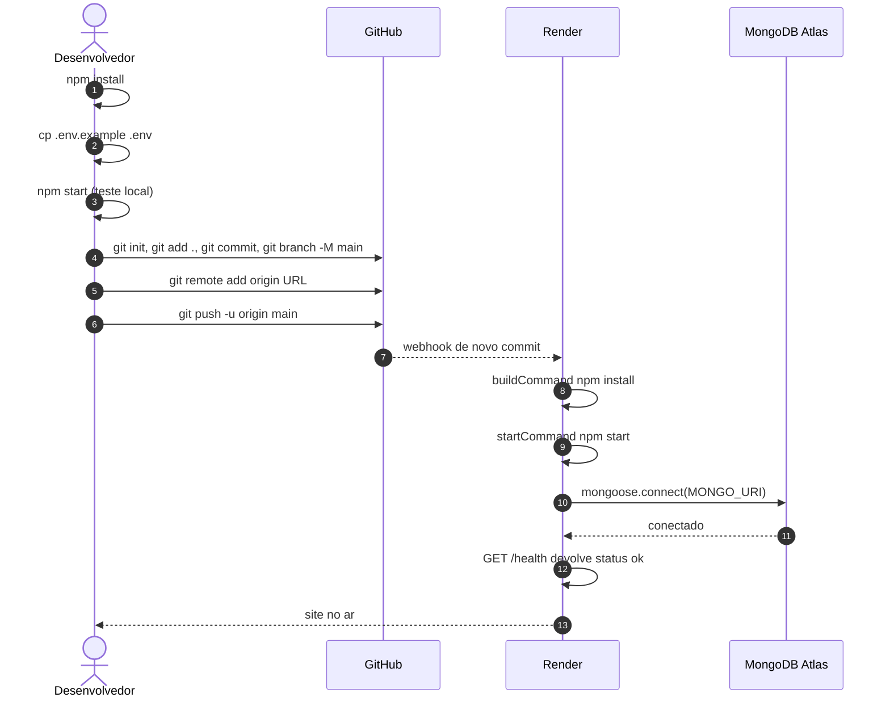

## 6. Catálogo de comandos

### 6.1 API REST

| # | Método | Rota | Login | Corpo (JSON) | Sucesso | Erros |
|---|---|---|---|---|---|---|
| 1 | GET | `/health` | não | — | 200 `{status, banco}` | — |
| 2 | POST | `/api/auth/register` | não | `{username, senha}` | 201 `{token, username}` | 400, 409 |
| 3 | POST | `/api/auth/login` | não | `{username, senha}` | 200 `{token, username}` | 401 |
| 4 | GET | `/api/auth/me` | sim | — | 200 `{username}` | 401 |
| 5 | GET | `/api/usuarios` | sim | — | 200 lista | 401 |
| 6 | POST | `/api/usuarios` | sim | `{username, senha}` | 201 usuário | 400, 409 |
| 7 | DELETE | `/api/usuarios/:username` | sim | — | 200 | 400, 404 |
| 8 | GET | `/api/produtos` | sim | — | 200 lista | 401 |
| 9 | POST | `/api/produtos` | sim | `{nome, preco, qtd}` | 201 produto | 400, 409 |
| 10 | PUT | `/api/produtos/:id` | sim | `{nome, preco, qtd}` | 200 produto | 400, 404, 409 |
| 11 | DELETE | `/api/produtos/:id` | sim | — | 200 | 400, 404 |
| 12 | GET | `/api/despensa` | sim | — | 200 lista por validade | 401 |
| 13 | POST | `/api/despensa` | sim | `{nome, categoria, quantidade, unidade, validade, local, valor}` | 201 item | 400, 409 |
| 14 | PUT | `/api/despensa/:id` | sim | mesmos campos | 200 item | 400, 404, 409 |
| 15 | DELETE | `/api/despensa/:id` | sim | — | 200 | 400, 404 |

### 6.2 Ações da interface → função → rota

| Ação na tela | Função em `script.js` | Rota |
|---|---|---|
| Abrir página | `init()` → `carregarDados()` | `GET /auth/me`, `GET /despensa`, `GET /produtos`, `GET /usuarios` |
| Entrar | `btnAuth` (login) → `iniciarSessao()` | `POST /auth/login` |
| Criar conta | `btnAuth` (cadastro) → `iniciarSessao()` | `POST /auth/register` |
| Sair | `btnSair` → `encerrarSessaoLocal()` | — |
| Adicionar/Salvar ingrediente | `submit` do `formProduto` | `POST` ou `PUT /despensa` |
| Editar ingrediente | `iniciarEdicaoDespensa()` | — (preenche o formulário) |
| Excluir ingrediente | `removerItemDespensa()` | `DELETE /despensa/:id` |
| Adicionar/Salvar produto | `btnProduto` | `POST` ou `PUT /produtos` |
| Excluir produto | `removerProdutoSimples()` | `DELETE /produtos/:id` |
| Cadastrar usuário | `btnUsuario` | `POST /usuarios` |
| Excluir usuário | `removerUsuario()` | `DELETE /usuarios/:username` |
| Imprimir / PDF | `imprimirRelatorio()` / `baixarPdf()` | — |

### 6.3 Terminal

| Comando | O que faz |
|---|---|
| `npm install` | instala as dependências |
| `cp .env.example .env` | cria o arquivo de configuração local |
| `node -e "console.log(require('crypto').randomBytes(48).toString('hex'))"` | gera o `JWT_SECRET` |
| `npm start` | inicia o servidor (`node server.js`) |
| `npm run dev` | inicia com reinício automático (`node --watch server.js`) |
| `git init` | cria o repositório local |
| `git add .` | prepara os arquivos |
| `git commit -m "mensagem"` | registra a versão |
| `git branch -M main` | nomeia a branch como `main` |
| `git remote add origin URL` | liga ao GitHub |
| `git push -u origin main` | envia o código (dispara o deploy no Render) |
| `curl URL/health` | testa se o servidor e o banco estão no ar |
